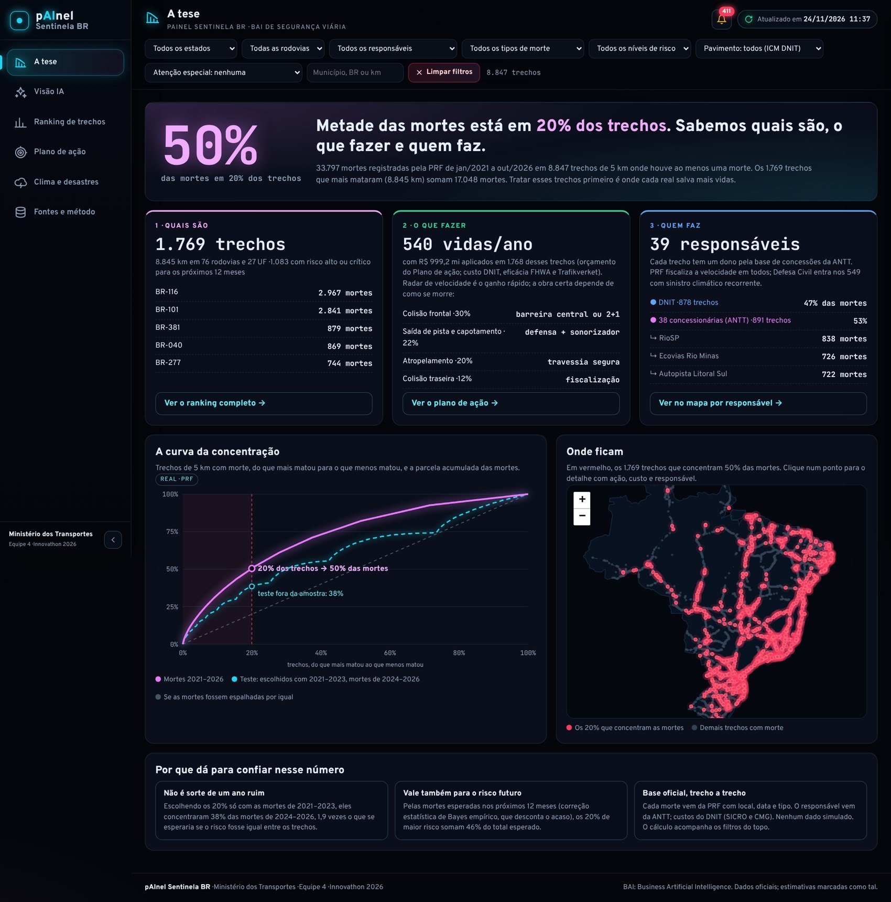
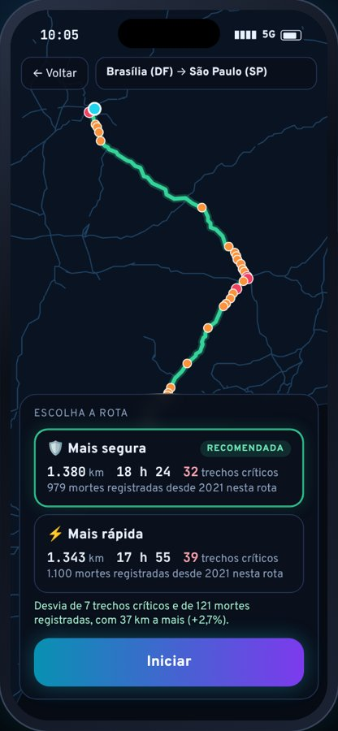
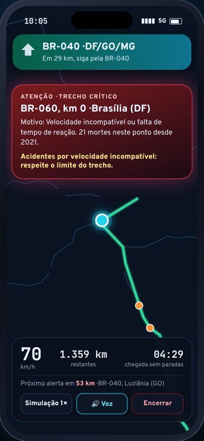

# pAInel Sentinela BR

**Business Artificial Intelligence (BAI) para reduzir mortes nas rodovias federais**
Ministério dos Transportes · Equipe 4 · Innovathon 2026

O pAInel Sentinela BR junta, em uma tela, as bases oficiais de sinistros, condição do pavimento, concessões e clima. Ele aponta **onde** se morre, **por que** se morre, **quem** é o responsável por cada trecho, **quanto custa** agir e **quantas vidas** cada real investido pode salvar. Não é um BI que pede ao gestor que deduza a ação: o painel entrega a projeção e o plano prontos, com fonte em cada número.

O projeto tem duas peças:

| Peça | Para quem | Arquivo pronto |
|---|---|---|
| **pAInel Sentinela BR** (BAI) | Gestores do Ministério dos Transportes, DNIT, ANTT, PRF, Senatran | [`dist/painel_sentinela_br.html`](dist/painel_sentinela_br.html) |
| **Sentinela BR · Rota Segura** (app do motorista) | Motoristas de carro, moto, ônibus e caminhão | [`dist/app_rota_segura.html`](dist/app_rota_segura.html) |

Os dois arquivos abrem com duplo clique no Chrome ou no Edge e funcionam sem internet.



## Números do painel (dados reais, jan/2021 a out/2026)

| Indicador | Valor | Fonte |
|---|---|---|
| Mortes em sinistros nas rodovias federais | 33.797 em 8.847 trechos de 5 km | PRF |
| Mortes esperadas nos próximos 12 meses, se nada mudar | 5.116 | Cálculo do painel (Bayes empírico) |
| Concentração | 50% das mortes em 20% dos trechos (1.769); no teste fora da amostra, 38% | PRF |
| Plano recomendado com R$ 1 bilhão | ≈ 593 vidas salvas por ano (estimativa) | DNIT (SICRO, CMG), FHWA, Trafikverket |
| Responsáveis | DNIT 58% das mortes; 38 concessionárias federais 42% | ANTT (trechos concedidos, 8/2026) |
| Pavimento | 77% das mortes da malha DNIT em pavimento **bom**; 5% em ruim ou péssimo | DNIT (ICM 2021 a out/2026) |
| Clima | 5.013 mortes em sinistros com chuva, neblina, fumaça, vento ou deslizamento (15%) | PRF |
| Desastres | 244 trechos com dupla evidência: sinistros climáticos recorrentes (PRF) e desastre recorrente no município (Defesa Civil), 1.941 mortes | Atlas Digital de Desastres (S2iD), PRF |
| Clima futuro | 42% das mortes em municípios com risco alto ou muito alto de inundação em 2050; 81 trechos com três evidências (691 mortes) | AdaptaBrasil (MCTI/INPE), Defesa Civil, PRF |
| País | 37.150 mortes no trânsito em 2024 (17,5 por 100 mil) e 36.955 em 2025, dado preliminar (17,3); meta Pnatrans 2030: 7,8 | SIM/MS (Open Data SUS), IBGE |

## O que o painel faz

- **A tese (tela de abertura):** metade das mortes em 20% dos trechos; quais são, o que fazer e quem faz, com a curva de concentração, o mapa e o teste fora da amostra (escolhidos com 2021–2023, os 20% concentraram 38% das mortes de 2024–2026).
- **Visão IA:** números-chave, "O que fazer agora", projeção até 2030 e comparação com a meta do Pnatrans.
- **Mapa** em três cores: risco, responsável (DNIT ou concessionária, por km) e pavimento (ICM do DNIT).
- **Ranking:** os 30 piores trechos e todos os 8.847, com detalhe de cada trecho (motivo, ação, custo, vidas salvas e responsável).
- **Plano de ação:** o gestor define o orçamento e recebe onde investir, em quê, quanto custa e quantas vidas salva.
- **Clima e desastres:** trechos com risco climático recorrente, calendário, alerta em pop-up e órgão líder de cada evento.
- **Filtros globais** que valem para todas as telas, botão Limpar filtros e selo de atualização com a lista de fontes.
- **Atualização automática** às 8h, 14h e 18h (Brasília).

## O que o app faz

Origem e destino entre os 5.571 municípios do IBGE, rota mais segura comparada com a mais rápida, alerta de voz 2 km antes de cada trecho perigoso com o motivo registrado pela PRF e pontos de bom condutor com incentivos. Os incentivos que já existem (RNPC, IPVA em alguns estados) aparecem separados dos que são proposta (pedágio, frotas). Detalhes em [`docs/APP.md`](docs/APP.md).

| Início | Rotas | Alerta | Chegada |
|---|---|---|---|
|  |  |  |  |

## Estrutura do repositório

```
real/consolidar_todos.py        consolida as bases da PRF (2021–2026)
sentinela_br/mvp/               adaptadores de leitura das bases
sentinela_br/viagem/            malha, perfis, estatísticas, dossiê e clima
sentinela_br/p6/                painel: preparar.py → dados.json; montar.py → saida/index.html
  antt_concessoes.py            responsável por km (base ANTT de trechos concedidos)
  icm_carga.py, icm_dnit.py     ICM do DNIT (leitura dos arquivos oficiais e download)
  atlas_desastres.py            Atlas Digital de Desastres (S2iD) por município
  adaptabrasil.py               AdaptaBrasil (MCTI/INPE): risco de inundação 2050 por município
  sim_transito.py               SIM/DataSUS: óbitos de trânsito (CID-10 V01–V89) do arquivo Mortalidade Geral
sentinela_br/appcel/            app do motorista (malha, municípios, montar_app.py)
sentinela_br/atualizacao/       rotina 8h/14h/18h e monitor de alertas do INMET
sentinela_br/docs/              geradores dos PDFs (fontes, guia, documento acessório)
dist/                           painel e app prontos (HTML único, offline)
powerbi/                        base para Power BI (tabelas, medidas DAX e selo de atualização)
docs/                           metodologia, fontes, uso do painel, app, atualização
```

## Como gerar

Requisitos: Python 3.12 e Node.js 20.

```bash
pip install -r sentinela_br/atualizacao/requirements.txt
npm install
export SENTINELA_BASE=$(pwd)/..   # pasta que contém real/ e sentinela_br/ (ajuste ao seu caso)
export SENTINELA_NODE_MODULES=$(pwd)/node_modules

# painel (usa o dados.json já incluído)
cd sentinela_br/p6 && python montar.py          # gera saida/index.html

# app do motorista
cd ../appcel && python montar_app.py            # gera saida/index.html

# atualização completa: baixa as bases, recalcula tudo e monta o painel
cd ../atualizacao && python atualizar.py
```

O ICM do DNIT pode ser recarregado a partir dos arquivos oficiais: `python sentinela_br/p6/icm_carga.py <pasta_com_os_arquivos>`. O layout de cada arquivo (2021 a 2026) é reconhecido pelo conteúdo.

Publicação contínua: o workflow [`.github/workflows/atualizar_painel.yml`](.github/workflows/atualizar_painel.yml) roda às 8h, 14h e 18h e publica no GitHub Pages. Para servidor próprio, use o [`Dockerfile`](Dockerfile). Detalhes em [`docs/ATUALIZACAO.md`](docs/ATUALIZACAO.md).

## Documentação

- [`docs/METODOLOGIA.md`](docs/METODOLOGIA.md): risco por trecho, projeções, plano de ação, clima, responsáveis e ICM.
- [`docs/FONTES.md`](docs/FONTES.md): glossário das fontes com links de acesso.
- [`docs/PAINEL.md`](docs/PAINEL.md): como usar o painel para decidir.
- [`docs/APP.md`](docs/APP.md): app do motorista e caminho para virar realidade.
- [`docs/ATUALIZACAO.md`](docs/ATUALIZACAO.md): rotina automática e alertas climáticos.
- PDFs em [`docs/pdf/`](docs/pdf): glossário das fontes e tutorial para decisão, tutorial do BAI, tutorial do app e guia da apresentação.

## Limites conhecidos

- Custos e vidas salvas são **estimativas** com fonte citada, não orçamento de obra.
- O ICM vale só para a malha administrada pelo DNIT; km concedidos ficam fora.
- A malha de rotas do app é reconstruída com as coordenadas da PRF. Em poucos trechos sem registro (partes da BR-319 e da BR-174), a ligação usa a distância em linha reta mais 25%. A malha oficial do DNIT (SNV) substitui essa aproximação no roadmap.
- O painel mostra só as bases conectadas. O AdaptaVias (risco climático por trecho) não tem dados abertos publicados; o risco climático vem da PRF, do Atlas Digital de Desastres e do AdaptaBrasil (risco municipal de inundação em 2050, que não mede a via em si).
- O parecer escrito por IA generativa funciona na versão publicada no Claude. Nos arquivos offline, a leitura automática do painel continua disponível.

## Equipe

Ministério dos Transportes · Equipe 4 · Innovathon 2026.

## Licença

A definir pela equipe antes da publicação.
